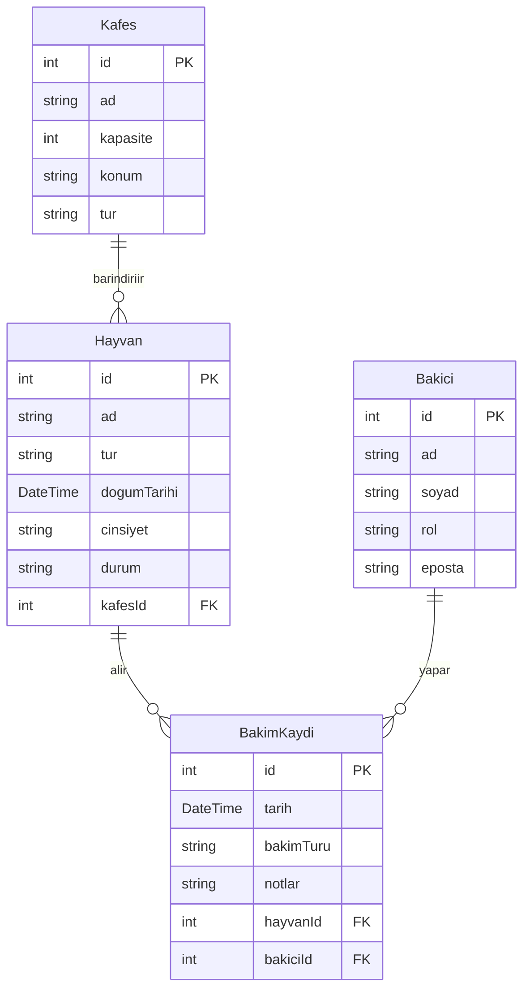

> 🌐 **Canlı adres:** https://hayvanat-bahcesi-XXXXXXXX.vercel.app *(yer tutucu — Vercel'e yayınlandıktan sonra güncellenecek)*

# 🦁 Okul Hayvanat Bahçesi — Hayvan Bakım Takip Sistemi

[](https://nextjs.org/)
[](https://www.typescriptlang.org/)
[](https://www.prisma.io/)
[](https://neon.tech/)

---

## Konsept

Bu uygulama, okul hayvanat bahçelerinde çalışan bakıcılar, öğretmenler ve yöneticiler tarafından kullanılmak üzere tasarlanmış bir hayvan bakım takip sistemidir. Sistemin temel amacı, her hayvanın hangi kafeste yaşadığını, kimlerin bakımını üstlendiğini ve hangi tarihlerde hangi tür bakım işlemlerinin (besleme, veteriner muayenesi, tımar vb.) yapıldığını kayıt altına almaktır. Okul hayvanat bahçelerinde hayvan refahını korumak ve bakım süreçlerini şeffaf biçimde belgelemek kritik öneme sahiptir; bu uygulama söz konusu süreci kâğıt tabanlı kayıtlardan dijital platforma taşır. Bakıcılar mobil cihazlardan günlük bakım kaydı girebilir, yöneticiler ise kafes doluluk oranlarını ve bakım geçmişini anlık olarak izleyebilir. Böylece hem hayvanların sağlık durumu takip edilir hem de öğrencilere hayvan bakımı konusunda gerçek verilerle eğitim verilebilir.

---

## Varlıklar

| Model | Açıklama | Anahtar Alanlar |
|-------|----------|----------------|
| `Kafes` | Hayvanın yaşadığı fiziksel alan | `ad`, `kapasite`, `konum`, `tur` |
| `Hayvan` | Hayvanat bahçesindeki her bir hayvan | `ad`, `tur`, `dogumTarihi`, `cinsiyet`, `durum`, `kafesId` |
| `Bakici` | Bakım yapan personel | `ad`, `soyad`, `rol`, `eposta` |
| `BakimKaydi` | Her bakım / muayene olayı | `tarih`, `bakimTuru`, `notlar`, `hayvanId`, `bakiciId` |

---

## İş Kuralları

1. **Kapasite kuralı** — Bir kafese, `kapasite` sınırını aşacak şekilde yeni hayvan eklenemez. Kafes doluysa sistem hata döner ve işlemi reddeder.
2. **Günlük bakım sınırı** — Aynı hayvan için aynı gün aynı `bakimTuru` türünde en fazla **3** kayıt oluşturulabilir. Bu kural aşırı/hatalı veri girişini önler.

---

## ER Diyagramı



---

## Kurulum (Geliştirme)

```bash
# 1. Repoyu klonla
git clone https://github.com/KULLANICI/hayvanat-bahcesi.git
cd hayvanat-bahcesi

# 2. Bağımlılıkları yükle
npm install

# 3. Ortam değişkenlerini ayarla
cp .env.example .env.local
# .env.local dosyasına Neon bağlantı dizesini gir:
# DATABASE_URL="postgresql://..."

# 4. Veritabanı şemasını uygula
npx prisma migrate dev --name init

# 5. Örnek verileri yükle
npx prisma db seed

# 6. Geliştirme sunucusunu başlat
npm run dev
```

Uygulama `http://localhost:3000` adresinde çalışır.

---

## Yayın (Vercel)

1. GitHub'da **private** repo oluştur ve `mertronot@gmail.com` collaborator olarak ekle.
2. [vercel.com](https://vercel.com) → *Import Git Repository* ile repoyu bağla.
3. Vercel → *Settings → Environment Variables* → `DATABASE_URL` ekle.
4. Build komutu olarak `npx prisma migrate deploy && next build` kullan.
5. Her `git push` otomatik production deploy tetikler.

---

## Proje Yapısı

```
src/
├── app/
│   ├── (hayvanlar)/       # Hayvan CRUD sayfaları
│   ├── (kafesler)/        # Kafes CRUD sayfaları
│   ├── (bakicilar)/       # Bakıcı CRUD sayfaları
│   ├── (bakim-kayitlari)/ # Bakım kaydı CRUD sayfaları
│   └── layout.tsx
├── lib/
│   ├── prisma.ts          # Prisma Client singleton
│   └── rules/             # İş kuralları (saf fonksiyonlar)
│       ├── kafes.rules.ts
│       └── bakim.rules.ts
prisma/
├── schema.prisma
├── migrations/
└── seed.ts
docs/
├── ai-log/                # Yapay zekâ konuşma kayıtları
└── YANSITMA.md
```
